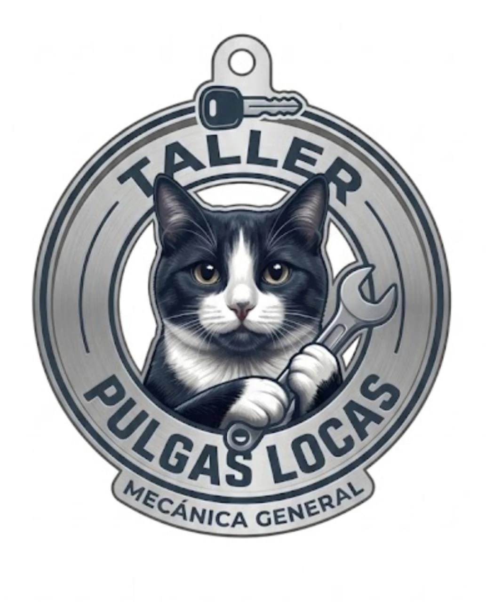

# Taller Pulgas Locas



Sistema de gestión de un taller de mecánica general. Todo gira alrededor de la **orden de servicio**:

1. Recepción registra al cliente y el vehículo, y abre la orden.
2. Un mecánico hace el **diagnóstico** paso a paso: tareas, horas estimadas, repuestos y costo con mano de obra.
3. El cliente aprueba el costo.
4. Uno o varios mecánicos hacen la **reparación**: registran horas y partes, que se descuentan del inventario.
5. Se liquida (servicios + tiempo + partes) y se entrega.

## Roles

| Rol | Qué hace |
|---|---|
| Administrador | Todo, además de usuarios, la descripción de los roles e integraciones |
| Recepcionista | Clientes y vehículos, órdenes, asignar mecánicos según su disponibilidad, aprobar, entregar, cancelar, inventario |
| Mecánico | Consulta sus carros asignados, registra el diagnóstico y la reparación |
| Concesionario | Usuario técnico del sistema que envía carros al taller (API y MCP) |

## Tecnología

| Parte | Stack |
|---|---|
| `api/` | Next.js 16 (solo rutas API) + TypeORM + PostgreSQL + zod, puerto 3001 |
| `web/` | React 19 + Vite + Tailwind CSS 4, puerto 5173 |
| MCP | Servidor MCP en `/mcp` con herramientas según el rol |

La API está preparada para conectarse por MCP con otros proyectos: **partes de vehículos**, **facturación** y el **concesionario**. Mientras no estén conectados, los mensajes quedan en una bandeja de salida y se envían después.

## Cómo correrlo

Requiere Node 24 y Docker. Las variables viven en el `.env` de la carpeta superior (`SENA-IA/.env`); vea la sección «Taller» de `SENA-IA/.env.ejemplo`.

```bash
# Base de datos (desde la carpeta SENA-IA)
docker compose up -d postgres
docker compose exec postgres createdb -U <DB_USUARIO> taller

# API
cd taller/api
npm install
npm run migracion:correr
npm run semilla
npm run dev

# Web (en otra terminal)
cd taller/web
npm install
npm run dev
```

Abra http://localhost:5173 y entre con el administrador definido en `TALLER_ADMIN_USUARIO` / `TALLER_ADMIN_CLAVE`.

## Pruebas

```bash
cd api && npm run pruebas   # pruebas unitarias de la API
cd web && npm run pruebas   # pruebas de componentes y páginas
cd api && npm run flujo     # punta a punta contra la API en marcha
```

La guía completa del proyecto (convenciones, reglas de negocio, permisos, diseño y contrato de integraciones) está en [CLAUDE.md](CLAUDE.md). El sistema visual está en [DESIGN.md](DESIGN.md).
