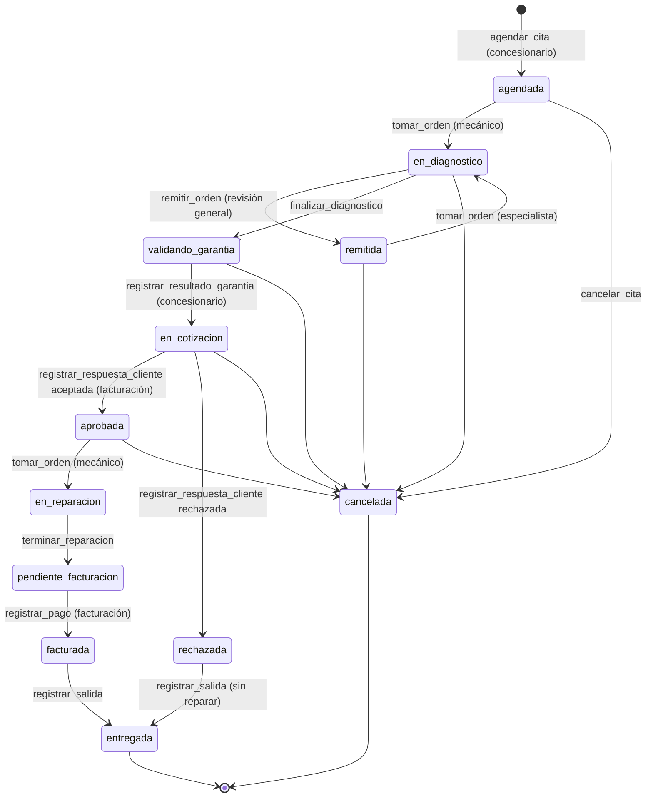

# Integración con el Taller Pulgas Locas S.A.S.

El taller es una pieza de un ecosistema de agentes. Cada sistema expone un servidor MCP y
los demás lo llaman:

| Sistema | Qué hace | Documento |
|---|---|---|
| **Concesionario** | Es dueño de la relación cliente–vehículo (`id_relacion`), de la API del VIN y de la garantía. Agenda las citas y valida la garantía. | [concesionario.md](concesionario.md) |
| **Taller** (este proyecto) | Varias sedes, de mantenimiento y especializadas. Prediagnostica, diagnostica, dictamina la garantía, repara y registra lo que usó. No tiene inventario. | — |
| **Facturación** | Cotiza los repuestos con las tiendas, le escribe al cliente por Telegram y cobra con PSE. | [facturacion.md](facturacion.md) |
| **Tiendas de repuestos** | Venden las partes. El taller solo consulta su catálogo para que el mecánico elija; facturación compra. | [tiendas.md](tiendas.md) |

Para probar sin los otros sistemas, el concesionario se simula con datos de prueba
([datos-simulados.md](datos-simulados.md)) y los mensajes a facturación quedan en la
bandeja de salida.

## Conexión

- **URL:** `POST http://localhost:3417/mcp` (Streamable HTTP, un servidor por petición).
- **Token fijo (lo más sencillo):** el taller tiene un token compartido para el ejercicio, que no vence. Pídaselo a quien administra el taller (es `TALLER_MCP_TOKEN_FIJO`, y `npm run semilla` lo imprime) y envíelo como `Authorization: Bearer <token>`. Entra como el usuario `agente-compartido`, con todas las herramientas.
- **Token propio (opcional):** si prefiere que el historial diga su nombre, pida un usuario de rol `agente`. Inicie sesión en `POST /api/auth/entrar` y con ese token pida `POST /api/auth/token-mcp`, que dura 7 días.
- Desde otro equipo de la red, cambie `localhost` por la IP del equipo del taller (`ipconfig` → Dirección IPv4).
- **Herramientas:** el rol `agente` (y el administrador) ve **todas**, porque el ejercicio es la comunicación entre agentes y orquestadores. El mecánico solo ve las suyas.
- **Recursos:**

  | Recurso | Contenido |
  |---|---|
  | `taller://flujo` | Estados, quién mueve cada uno y con qué herramientas. |
  | `taller://contrato` | Lo que el taller expone y lo que llama. |
  | `taller://talleres` | Las sedes. |
  | `taller://servicios` | El catálogo de SKU con precio. |

  La herramienta `describir_flujo` devuelve lo mismo en JSON.

## Flujo



**Paso a paso:**
1. El concesionario envía los **mensajes del cliente** a `prediagnosticar`. El agente de prediagnóstico del taller responde la especialidad, los servicios probables con su precio y la **ruta**:
   - `especializada`: el síntoma es claro y va directo a la sede especialista.
   - `revision_general`: no se sabe qué tiene. Pasa primero por mantenimiento, que luego **remite** a la especializada. La revisión general (`REV-GENERAL`) se cobra junto con la especialidad.

   El agente usa el modelo local (`LOCAL_URL`). Si no responde, usa reglas por palabras clave y lo dice en `fuente`.
2. `agendar_cita` en una franja libre (`consultar_disponibilidad`). La cita puede venir `por_garantia`, con el motivo del reclamo.
3. Un mecánico de la sede **toma** la orden. Registra cada servicio (SKU con precio fijo), la **causa** de la falla y su **dictamen de garantía** (aplica o no y por qué), con **evidencias**, y los **repuestos a comprar**: los busca en el catálogo de las tiendas, filtrado por marca, modelo y año del vehículo (`buscar_repuestos_tienda`), y el taller guarda tienda, `repuesto_id`, SKU y cantidad, **sin precio**.
4. **Toda orden se consulta al concesionario**, venga o no por garantía. El taller envía `validar_garantia` y el concesionario responde con `registrar_resultado_garantia`, por servicio.
5. El taller envía a facturación `crear_cotizacion`. Lleva la mano de obra con precio, los repuestos sin precio, la garantía de cada línea y el `mensaje_garantia` para el cliente. Facturación busca precios en las tiendas, le escribe al cliente por Telegram y responde con `registrar_respuesta_cliente`, que incluye la orden de compra si el cliente acepta.
6. El mecánico repara. Registra las horas (solo de control), los servicios hechos y las **partes usadas**, y termina. El taller envía a facturación `notificar_reparacion_terminada`.
7. Facturación cobra por PSE y confirma con `registrar_pago`. El vehículo sale con `registrar_salida`.

En cada cambio de estado el taller le envía `notificar_estado_vehiculo` al concesionario.

## Garantía

El **mecánico** dictamina y el **concesionario** valida. El dictamen sugerido sale de la
causa, pero el mecánico puede cambiarlo y explicar por qué.

| Causa | Dictamen sugerido | Si el concesionario la valida, paga |
|---|---|---|
| `defecto_fabrica` | aplica | fabricante |
| `repuesto_defectuoso` | aplica | tienda |
| `mala_instalacion_taller` | aplica | taller |
| `manipulacion_cliente` | no aplica | cliente |
| `desgaste_normal` | no aplica | cliente |

- Para finalizar el diagnóstico, cada servicio con causa necesita su motivo.
- Hacen falta evidencias si el dictamen dice «aplica» o si la orden vino por garantía.
- La garantía vigente se calcula con el `id_relacion`: 3 años desde la venta o 60.000 km, y solo los sistemas que cubre.

## Reglas para los agentes

**Respuestas.** Toda respuesta sobre una orden trae:
- `estado`.
- `siguiente_paso`: `{ responsable, descripcion }`. El responsable es `concesionario`, `facturacion`, `mecanico`, `taller` o `nadie`.
- `acciones_disponibles`: las herramientas que tiene sentido llamar ahora.

Con eso un orquestador encadena el flujo sin conocer la lógica interna.

**Datos estructurados.** Cada herramienta declara su `outputSchema` y devuelve `structuredContent`, además del texto.

**Idempotencia.**
- Las herramientas que cambian algo aceptan `id_mensaje`.
- Si un reintento repite el mismo `id_mensaje`, el taller devuelve la respuesta de la primera vez y no repite el cambio.
- Use un id único por intención, por ejemplo un UUID, y el mismo en cada reintento.

**Errores.** Los de negocio vuelven como resultado con `isError: true` y un mensaje que dice qué hacer. Por ejemplo:
- `La orden OT-0007 está en_cotizacion: no hay nada que tomar`.
- `«Cambio de pastillas de freno»: el dictamen dice que aplica garantía; adjunte al menos una evidencia`.

No se reintentan: hay que corregir la llamada.

**Lo ajeno.** Un mecánico que pide una orden de otra sede recibe «no existe».

## Mensajes salientes y bandeja

El taller nunca llama a otro sistema dentro de una transacción. Escribe el mensaje en
`eventos_integracion` y un despachador lo envía:
- Hace 5 intentos antes de marcarlo `fallido`.
- Sin `MCP_<DESTINO>_URL`, el destino queda `desactivado` y el mensaje se guarda.

Para revisar y reenviar:
- `consultar_bandeja` muestra los mensajes.
- `reintentar_envios` los reenvía.

Configuración:

| Variable | Para qué |
|---|---|
| `MCP_CONCESIONARIO_URL` / `MCP_CONCESIONARIO_TOKEN` | Sin URL, el concesionario es el simulado y responde la garantía al instante. |
| `MCP_FACTURACION_URL` / `MCP_FACTURACION_TOKEN` | El MCP de facturación. |
| `TALLER_URL_PUBLICA` | La dirección con la que el concesionario descarga las evidencias. |
| `MCP_TIENDA_<N>_URL` / `_TOKEN` / `_NOMBRE` | Las tiendas de repuestos (N = 1…9). Sin ninguna, se usa la tienda simulada. |

## Probar

```bash
cd taller/api
npm run simular -- casos      # lista los 11 casos (garantía, rutas, rechazo…)
npm run simular -- todos      # los corre todos por MCP, como un orquestador
npm run flujo                 # el lado manual por REST, con los permisos
```
